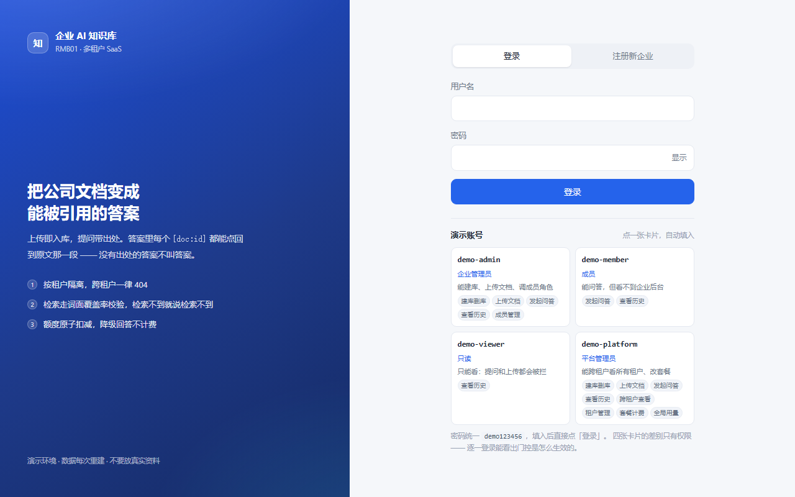
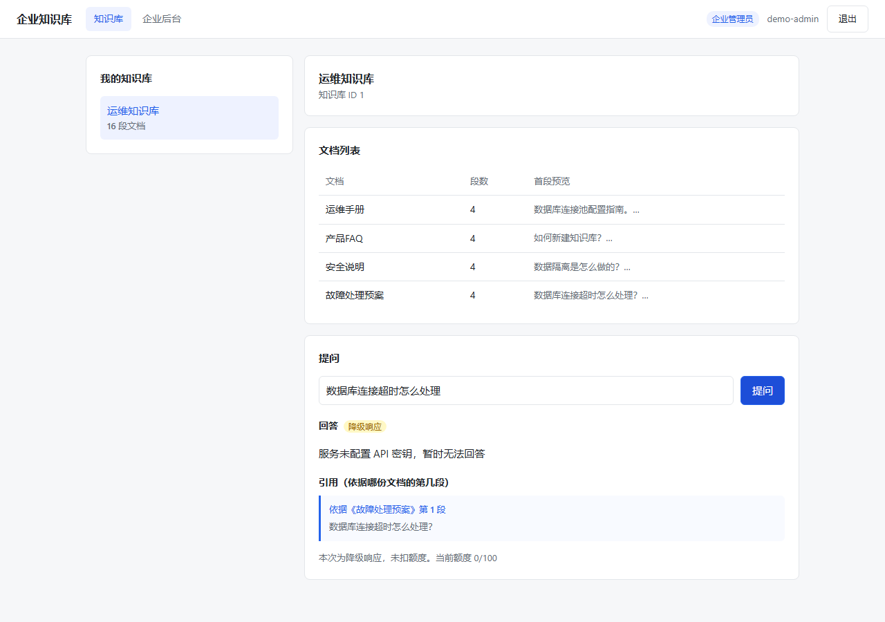
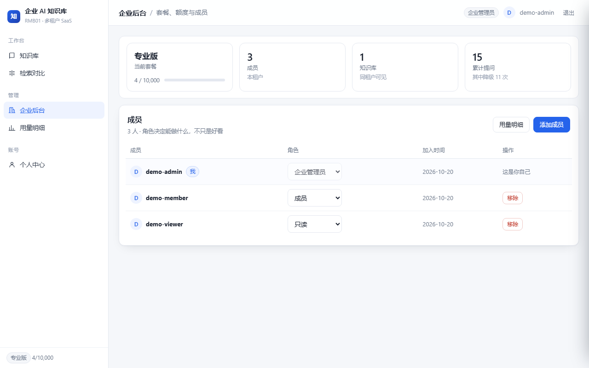
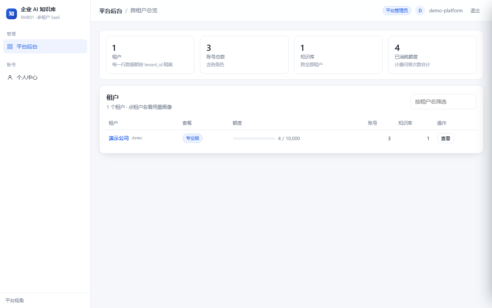

# 演示截图 · RMB01

> 🔴 **这 4 张是真实运行的截图，不是设计稿。**
> 由 `make_screenshots.py` 驱动 Playwright 访问 `http://127.0.0.1:5099` 拍下来的，
> 每张都断言了页面元素真的渲染出来（不是拍一张空白当成功）。

复跑：

```bash
python app.py                # 起服务（5099）
python make_screenshots.py   # 自动灌数据 + 截图 4 张
python reshoot_kb.py         # 只重拍第 2 张（改了取景参数时用）
```

---

## 1 · 登录页



| 元素 | 说明 |
|---|---|
| 用户名 / 密码 | 登录 |
| **注册新租户** 按钮 | 点开后会多一个「公司 / 租户名」输入框 |
| 演示账号提示 | `demo-admin / demo123456` |

**为什么没有「选择租户」下拉**：一个账号固定属于一个租户（`user.tenant_id`）。
需要跨租户的人用 `platform_admin`，那是另一套视角。

---

## 2 · 知识库问答（核心页）



> 1280x900。视口取 900 是为了把「答案 + 引用卡片」一起装进一屏 —— 800 高时引用卡片会掉到视口外，截出来只剩文档列表。
> 单独重拍用 `python reshoot_kb.py`（只动这张，不碰另外 3 张）。

**这一张就是整个项目的卖点**：

| 区块 | 内容 |
|---|---|
| 顶部导航 | 当前是「企业管理员」，所以有「知识库 / 企业后台」，**没有「平台后台」** |
| 左栏 | 我的知识库列表 |
| 中栏 | 文档列表：4 份文档各 4 段 |
| 提问区 | 「数据库连接超时怎么处理」 |
| **回答** | 带 `降级响应` 徽标（没配 API key 时如实标注） |
| 🔴 **引用** | **「依据《故障处理预案》第 1 段」** —— 精确到段 |

**这张图证明的链路**：
上传《故障处理预案》→ 分段 → 提问 → 检索命中第 1 段 → 引用指回去。

---

## 3 · 企业后台



真实数据，不是占位：

| 指标 | 值 | 说明 |
|---|---|---|
| 本期已用 | **0** | 🔴 降级问答不扣额度，所以是 0 |
| 总额度 / 剩余 | 100 / 100 | 免费版 |
| **降级次数** | **1** | 与「已用 0」并列，说明降级确实没计费 |
| 知识库 / 成员 | 1 / 2 | |
| 成员管理 | demo-admin（企业管理员）/ demo-member（成员） | 角色下拉可直接改 |

导航栏显示「知识库 / 企业后台」，**无「平台后台」**——企业管理员看不见。

---

## 4 · 平台后台



| 区块 | 内容 |
|---|---|
| 用量排行 | 演示公司 `free` `0/100` |
| 全部租户 | ID / 名称 / 套餐 / 已用总额 / 成员 / 知识库 |
| 变更套餐 | 租户下拉 + 套餐下拉 |

🔴 图里那句提示是刻意写上去的：

> 降级时如果已用量超过新额度，接口会返 **409** 并说明原因 ——
> 不会自动截断已用量（那等于凭空抹掉客户已消耗的额度）。

导航栏这次有「平台后台」，因为登录的是 `demo-platform`（平台管理员）。

---

## 页面清单与权限

| 路由 | 谁能进 | 截图 |
|---|---|---|
| `/login` | 所有人 | ✅ |
| `/kbs` | 已登录 | ✅ |
| `/org` | **仅企业管理员** | ✅ |
| `/platform` | **仅平台管理员** | ✅ |

权限矩阵（`tests/test_pages.py` 锁着，不是嘴上说）：

| 角色 | `/kbs` | `/org` | `/platform` |
|---|---|---|---|
| 企业管理员 | 200 | 200 | **403** |
| 成员 | 200 | **403** | 403 |
| 只读 | 200 | **403** | 403 |
| 平台管理员 | 200 | **403** | 200 |

---

## 截图工具的坑（留给以后）

试过 Tabbit（这个环境里的 Playwright 封装），**连续拍照时每张都超时**
（日志停在 `fonts loaded` 之后，40 秒拍不下来）。前 3 张成功，之后一直失败。

改用本地 Playwright + `make_screenshots.py`，一次跑完 4 张，稳定。

⚠️ Chromium 下载走了国内镜像：官方源 0.2 MB/s（197 MB 要 16 分钟），
`cdn.npmmirror.com` 2.1 MB/s（56 秒）。切换方式：

```bash
# 先测速再选源
curl -o /dev/null -w '%{speed_download}' \
  https://cdn.npmmirror.com/binaries/chrome-for-testing/156.0.8078.4/win64/chrome-headless-shell-win64.zip
```

Playwright 要的是 **headless-shell**（118 MB），不是完整 chrome（197 MB）。

---

*（4 张真实截图 · 2026-10-17）*
